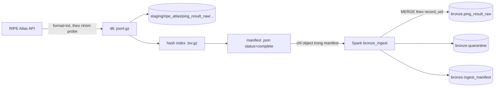

# Data contracts: staging và Bronze

Phiên bản: v1 (giai đoạn 2, 2026-11-19).
Code tương ứng:
- `ingestion/` (staging)
- `transformation/lakehouse/bronze.py` và `transformation/jobs/bronze_ingest.py` (Bronze)
- `transformation/sql/bronze.sql` (DDL)

## 1. Đơn vị tiến độ và luồng

- **Đơn vị tiến độ:** (measurement_id, cửa sổ 1 giờ `[start, end)` theo UTC). Mỗi đơn vị là một lần chạy dlt, tạo một `load_id` và một manifest.
- **Checkpoint của ingestion:** chính các manifest trên staging, không dùng state dlt local. Pipeline dlt chạy trong thư mục tạm, nên không có pending package cũ nào bị load lại ngoài ý muốn.
- **Checkpoint của Bronze:** bảng `bronze.ingest_manifest`. Một manifest được coi là đã nạp khi có ít nhất một dòng `bronze_status = 'loaded'`.

## 2. Staging (bucket `staging`)

| Đường dẫn | Nội dung |
|---|---|
| `ripe_atlas/ping_result_raw/window_date=D/window_hour=H/msm_id=N/<load_id>.<file_id>.jsonl.gz` | Result thô, mỗi dòng là một record dlt |
| `ripe_atlas/probe_metadata_raw/ictrl_dt=D/<load_id>...jsonl.gz` | Snapshot metadata probe |
| `ripe_atlas/measurement_metadata_raw/ictrl_dt=D/<load_id>...jsonl.gz` | Snapshot metadata measurement |
| `ripe_atlas/_manifests/<entity>/<partition>/<run_id>.json` | Receipt: object, số đếm, request, hash |
| `ripe_atlas/_index/ping_result_raw/<partition>/<run_id>.tsv.gz` | `probe_id, event_ts, raw_sha256` đã stage |
| `ripe_atlas/_probe_sets/<version>.json` | Bản sao probe set đã dùng |

- `window_date` và `window_hour` theo giờ **Asia/Ho_Chi_Minh**.
- Đây chỉ là cách tổ chức thư mục staging. Partition Iceberg định nghĩa riêng ở §3.

### Record `ping_result_raw` (staging)

| Trường | Kiểu | Ý nghĩa |
|---|---|---|
| `raw_json` | text | **Nguyên văn** một dòng body `format=txt`, giải mã UTF-8; không parse/serialize lại |
| `raw_sha256` | text | SHA-256 của **đúng bytes dòng đó**, không gồm `\n`, tính trước khi dlt serialize và gzip |
| `measurement_id` | bigint | measurement được gọi (từ request, không lấy từ payload) |
| `probe_id`, `event_ts` | bigint, null được | Trích từ payload để lập index; null nếu không parse được |
| `parse_status` | text | `ok`, `malformed_json`, `not_object`, `missing_key`, `wrong_measurement`, `af_mismatch`, `out_of_window`, `invalid_utf8`. Chỉ để tham khảo; Bronze kiểm tra lại |
| `change_type` | text | `new` hoặc `changed` (so với các lần stage trước của cùng cửa sổ) |
| `line_no`, `request_index` | bigint | Vị trí trong response, phục vụ truy vết |
| `run_id`, `fetched_at` | text | Lần thu thập |
| `_dlt_load_id`, `_dlt_id` | text | Do dlt thêm vào |

**Hai loại hash, phân biệt rõ:**
- `raw_sha256` (theo record) = hash của bytes dòng nguồn.
- `manifest.requests[].body_sha256` = hash của **toàn bộ body HTTP** sau khi `requests` giải mã Content-Encoding, trước gzip của dlt.

### Metadata

- `measurement_metadata_raw.raw_json` là nguyên văn body của `GET /measurements/{id}/` (`raw_encoding = http_body`).
- `probe_metadata_raw.raw_json` là JSON canonical (`sort_keys`, compact) của **một phần tử** trong trang `results` (`raw_encoding = canonical_json`).
  - Lý do: API trả về nhiều probe trong một trang. Hash nguyên body từng trang nằm trong manifest.
- Probe được yêu cầu nhưng API không trả về sẽ có record `fetch_status = not_returned`, `raw_json = null`.
- Metadata probe **không lọc `is_public`**, nên ghi nhận được cả probe đã chuyển sang private.

### Chống trùng khi tải chồng lấn

- Trước khi gọi API, job đọc hash index của mọi manifest hoàn tất cho cùng (measurement, cửa sổ).
- Record có `raw_sha256` đã gặp sẽ **không stage lại** (`unchanged`).
- Cùng `(probe_id, event_ts)` nhưng hash khác được stage với `change_type = changed`. Đây là trường hợp nguồn sửa dữ liệu.
- Nhờ vậy, overlap 3 giờ không làm staging phình gấp 4 lần.
- Đã kiểm chứng thật ngày 2026-11-19: tải lại giờ 00 và 01 UTC cho `unchanged = fetched`, `staged = 0`.

### Ghi một phần và thất bại

| Tình huống | Hệ quả | Phục hồi |
|---|---|---|
| Lỗi HTTP sau hết số lần retry | Không có object, không có manifest | Lần chạy sau làm lại cửa sổ |
| dlt ghi được object nhưng thất bại trước khi ghi manifest | Object mồ côi, không manifest nào tham chiếu | Downstream bỏ qua; lần sau stage lại (test `test_failed_load_leaves_no_manifest`); dọn object mồ côi theo §5 |
| Đã ghi manifest nhưng Bronze chưa chạy | Manifest ở trạng thái chờ | Bronze lần sau tự nhận |
| Hai run cùng xử lý một cửa sổ | Có thể stage cùng nội dung hai lần | Bronze khử trùng theo `record_uid`, giữ bản `fetched_at` sớm nhất (test Spark) |

## 3. Bronze (namespace `nessie.bronze`)

| Bảng | Grain | Khóa | Partition | Ghi |
|---|---|---|---|---|
| `ping_result_raw` | Một nội dung result duy nhất | `record_uid = sha256(measurement_id\|probe_id\|event_ts\|raw_sha256)` | `ictrl_dt, measurement_id`; sort `probe_id, event_ts` | MERGE WHEN NOT MATCHED INSERT |
| `probe_metadata_raw` | Một probe × một lần snapshot | `sha256(probe_id\|ingest_run_id)` | `ictrl_dt` | MERGE insert |
| `measurement_metadata_raw` | Một measurement × một lần snapshot | `sha256(measurement_id\|ingest_run_id)` | `ictrl_dt` | MERGE insert |
| `quarantine` | Một bản ghi lỗi × một lý do × một manifest | `quarantine_uid` | `entity, ictrl_dt` | MERGE insert |
| `ingest_manifest` | Một lần Bronze xử lý một manifest (audit append-only) | `manifest_path, bronze_run_id` | `entity, ictrl_dt` | MERGE insert |

**Cách nhận diện các trường hợp trùng:**

| Trường hợp | Nhận diện | Kết quả |
|---|---|---|
| Cùng object hoặc manifest được xử lý lại | `ingest_manifest` đã có `loaded`; dùng `--reprocess` thì MERGE theo `record_uid` | 0 dòng mới (đã kiểm chứng: `rows_inserted = 0`, `rows_already_present = 22.113`) |
| Cùng result xuất hiện ở các lần tải chồng lấn | Cùng `raw_sha256` | Không stage lại; nếu lọt qua thì cùng `record_uid` |
| Cùng business key nhưng payload khác | Cùng `(measurement_id, probe_id, event_ts)`, khác `record_uid` | Giữ cả hai trong Bronze; Silver chọn theo quy tắc xác định (giai đoạn 3) |
| JSON lỗi, thiếu khóa, sai kiểu | `reason` trong quarantine | Cách ly, không chặn batch |

**Lý do chọn partition:**
- Khối lượng chế độ `analysis` ước tính ≈ 5,6 triệu result/ngày, tức khoảng 1,4 triệu/ngày cho mỗi measurement.
- Partition theo **ngày × measurement** cho mỗi partition vài chục đến hơn 100 MB sau compaction.
- Partition theo giờ sẽ sinh 96 partition/ngày với file vài MB.
- Truy vấn chủ yếu lọc theo khoảng ngày và measurement.

`ictrl_dt` là ngày Asia/Ho_Chi_Minh của **cửa sổ logic**. Với results, cửa sổ chứa trọn event, nên `ictrl_dt` cũng là ngày báo cáo của event.

**`raw_json` được giữ trong Bronze** để có thể dựng lại Silver khi logic thay đổi mà không phải gọi lại API. Schema nguồn thay đổi (fw/mver) không làm hỏng Bronze, vì chỉ trích các trường định danh.

## 4. Quarantine và điều kiện làm batch thất bại

**Mức bản ghi → quarantine, batch vẫn chạy:**

| reason | Điều kiện (theo thứ tự ưu tiên) |
|---|---|
| `invalid_utf8` | Dòng nguồn không phải UTF-8 hợp lệ |
| `hash_mismatch` | `sha2(raw_json) ≠ raw_sha256` |
| `malformed_json` | Không parse được, hoặc sai kiểu. Spark PERMISSIVE coi `"prb_id":"12"` là corrupt (đã kiểm chứng bằng test) |
| `missing_key` | Thiếu `msm_id`, `prb_id`, `timestamp` hoặc `af` |
| `wrong_measurement` | `msm_id` khác measurement đã gọi |
| `af_mismatch` | `af` khác af của measurement |
| `wrong_type` | `type ≠ 'ping'` |
| `out_of_window` | `timestamp ∉ [window_start, window_end)` |
| `id_mismatch` | Chỉ với metadata: `id` trong payload khác `entity_id` |

**Mức batch → job thất bại, không ghi gì:**
- Object liệt kê trong manifest không tồn tại.
- Số dòng đọc được khác `counts.staged` của manifest.
- `_dlt_load_id` khác `load_id` của manifest.
- Tỷ lệ quarantine lớn hơn `--max-quarantine-ratio` (mặc định 5%). Tỷ lệ cao báo hiệu nguồn đổi schema, cần người xem xét.

**Tái xử lý:**
- Bản ghi quarantine giữ `raw_json`, `manifest_path` và `reprocess_status = pending`.
- Sau khi sửa logic, chạy lại `bronze_ingest.py --reprocess` cho phạm vi tương ứng. Bản ghi hợp lệ được MERGE vào; bản ghi đã có thì giữ nguyên.

**Result mất toàn bộ packet (`rcvd = 0`, `avg = -1`) là dữ liệu hợp lệ**, đi thẳng vào Bronze.

## 5. Commit, nguyên tử và vận hành

- Mỗi `MERGE` là **một commit Iceberg nguyên tử trên một bảng**. Không có giao dịch xuyên bảng.
- Thứ tự commit: (1) bảng dữ liệu → (2) `quarantine` → (3) `ingest_manifest`.
  - Job chết sau (1) thì manifest chưa được đánh dấu, lần sau xử lý lại.
  - MERGE theo khóa bảo đảm không nhân bản. Hệ quả: "exactly-once" ở mức **nội dung trong Bronze**, với điều kiện khóa `record_uid` đúng.
- **Compaction**: chưa triển khai, cần làm.
  - Đo ngày 2026-11-19: sau 6 lần nạp theo giờ, mỗi partition ngày có 6–8 file khoảng 200 KB.
  - Kế hoạch: chạy `CALL nessie.system.rewrite_data_files('bronze.ping_result_raw', where => 'ictrl_dt < current_date')` hằng ngày cho các ngày đã đóng, rồi `expire_snapshots` giữ 7 ngày và `remove_orphan_files` với `older_than` ≥ 3 ngày. Ngưỡng 3 ngày để không xóa file của job đang ghi hoặc của reader đang đọc snapshot cũ.
- **Staging retention**: đề xuất giữ object và manifest 30 ngày để có thể dựng lại Bronze; object mồ côi (không manifest nào tham chiếu) xóa sau 2 ngày. Chưa triển khai.

## 6. Bảng cũ (legacy)

Các bảng cũ **không bị sửa hay xóa**:
- `nessie.bronze.measurements`, `nessie.bronze.probes`, `nessie.bronze.ping_results`
- `nessie.silver.dim_probe`, `nessie.silver.dim_measurement`, `nessie.silver.fact_ping`
- Staging cũ dưới `ripe_atlas/{measurements,probes,ping_results}/`

Pipeline mới dùng tên bảng mới, nên hai bộ không đè lên nhau. Việc xóa các bảng cũ cần chủ đồ án đồng ý; dự kiến làm sau giai đoạn 3, khi Silver mới đã thay thế.
