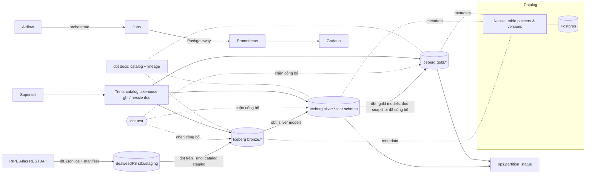

# Thiết kế tổng thể, giả định và tiêu chí nghiệm thu

Trạng thái: **BẢN NHÁP v0.1 (2026-11-18)**, cập nhật 2026-11-21: tầng biến đổi chuyển từ Spark sang **dbt trên Trino**, bỏ
Great Expectations (thay bằng dbt test) và OpenMetadata (thay bằng dbt docs), xem ADR-0003. Mục 1–3 theo kiến trúc hiện tại;
mục 4–7 là khảo sát ban đầu, giữ lại để đối chiếu. Các mục đánh dấu ❓ đang chờ chủ đồ án quyết định (xem `docs/status.md`).

## 1. Phạm vi

- Nguồn: đúng 4 built-in ping measurements **1001** (v4, K-root), **1004** (v4, F-root), **2001** (v6, K-root) và **2004** (v6, F-root). Metadata đã đối chiếu ở `docs/api-survey.md` §1.
- Hằng số `measurement_id → (af, target)` được khai báo **một lần** trong config. Mỗi tầng kiểm tra lại với `dim_measurement`; nếu lệch thì dbt test báo critical.
- Câu hỏi phân tích, người dùng và giới hạn suy luận: theo đề bài, tóm tắt trong `docs/requirements.md` (giai đoạn 1).
- **Ngoài phạm vi:** băng thông, chất lượng dịch vụ Internet nói chung. Instance anycast chỉ được gán khi có bằng chứng từ dữ liệu; ping result **không** chứa định danh instance, nên ta **không** gán vị trí hay instance.

## 2. Giả định (mặc định của đề bài, chưa bị repo hiện có thay đổi)

| # | Giả định | Ghi chú |
|---|---|---|
| A1 | Pipeline chạy hàng giờ, cửa sổ logic `[start, end)` | Repo hiện có đã dùng cửa sổ 1 giờ |
| A2 | `event_time` lưu UTC; `ictrl_dt` và ngày báo cáo theo `Asia/Ho_Chi_Minh` | Repo dùng offset cố định `+07:00`. Việt Nam không có DST nên kết quả tương đương; sẽ chuyển sang `zoneinfo("Asia/Ho_Chi_Minh")` để đúng ngữ nghĩa |
| A3 | Gold mới trong ≤ 2 giờ tính từ `event_time` | Độ trễ nguồn đo được (`stored_timestamp - timestamp`) ≈ 0,5–2 phút, nên khả thi |
| A4 | Tải lại chồng lấn 3 giờ, có cấu hình | `OVERLAP_HOURS=3` |
| A5 | Metadata probe/measurement lấy khi khởi tạo và hằng ngày; probe mới xuất hiện trong results được bổ sung qua `GET /probes/?id__in=` | |
| A6 | Điều phối bằng **Airflow** (repo chưa có scheduler) | Chi phí ≈ 1,5–2 GB RAM. Phương án nhẹ hơn: lệnh `make`/CLI + cron. Xem ADR-0002 |
| A7 | Dev dùng tập probe nhỏ, cố định (repo đã có 200 probe chia theo châu lục). Chế độ phân tích chính nhắm toàn bộ public probes | ❓ chưa khả thi trên máy hiện tại, xem §4 |
| A8 | Public status lấy theo snapshot lúc thu thập. Backfill trước snapshot đầu tiên đánh dấu `public_status_certainty = 'assumed_current'` | API không có lịch sử `is_public` |

## 3. Kiến trúc

- **Nessie và dbt docs:** Nessie là *catalog kỹ thuật*. Nó giữ con trỏ tới metadata file mới nhất của mỗi bảng Iceberg, với commit và branch; nhờ đó catalog ghi `lakehouse` và catalog đọc `nessie` của Trino thấy cùng một snapshot. dbt docs là *catalog nghiệp vụ*: mô tả, test và lineage sinh từ dự án dbt (`docs/governance.md`). Nó không tham gia đường ghi dữ liệu.
- **Bucket** (giữ nguyên như repo): `staging` chứa dữ liệu thô dlt, manifest và artifact vận hành; `warehouse` chứa dữ liệu và metadata Iceberg. Tên bucket cấu hình qua `STAGING_BUCKET`, `WAREHOUSE_BUCKET`.
- **Phân quyền S3** (đã có trong `storage/seaweedfs/s3.json` của repo, giữ nguyên):

  | Identity | Quyền |
  |---|---|
  | `atlas-ingest` | Ghi `staging` |
  | `atlas-processing` | Đọc `staging`, ghi `warehouse` (Trino catalog `lakehouse`/`staging`, runner transform) |
  | `atlas-reader` | Chỉ đọc `warehouse` (Trino catalog `nessie`) |
  | `storage-admin` | Tạo bucket |

## 4. Đánh giá tài nguyên và phạm vi chạy

**Máy hiện tại** [Đo, 2026-11-18]:

- 12 CPU logic, RAM host 15,8 GB (lúc đo còn trống 1,8 GB).
- Docker Desktop được cấp **8,2 GB** RAM.
- Ổ **C: còn trống 13,2 GB**; Docker data nằm trong WSL (`/var/lib/docker`, thường ở C:). Ổ D: còn trống 68,7 GB.
- Docker đang có 6,5 GB build cache có thể giải phóng.

**Khối lượng toàn bộ public probes** [Đo 5 phút, ngoại suy]: ≈ 16 triệu result/ngày; staging ≈ 1,2 GB/ngày; toàn hệ ước tính ≈ 3 GB/ngày.
Với 13 GB trống trên C:, chế độ toàn cầu chỉ giữ được **≈ 3–4 ngày** dữ liệu, sau khi đã trừ image còn thiếu (≈ 8–10 GB). Vì vậy:

- **Probe set duy nhất `dev-200-v2`** (từ 2026-11-22): 200 probe cố định, gồm mọi probe Việt Nam đang hoạt động (42 probe,
  20 ASN), ≈ ≤ 12k result/giờ. Tên nhà mạng theo ASN ở seed `asn_info`.
- ~~Chế độ `analysis`: mẫu phân tầng (country × ASN × af)~~: đã bỏ ngày 2026-11-22 (ADR-0001 bị thay thế).
  - Thuật toán và số liệu ở `docs/adr/0001-probe-sampling.md`.
  - Đề xuất k = 2, trần 100 probe/quốc gia ≈ 4.290 probe v4 và 2.869 probe v6, ước tính ≈ 1 GB/ngày.
  - Docker data sẽ được chủ đồ án chuyển sang D:.

**Ước tính RAM theo profile** (ước tính, sẽ đo bằng `docker stats` ở từng giai đoạn):

| Profile | Service | RAM ước tính |
|---|---|---|
| `core` | SeaweedFS ×4, Nessie, Postgres, Spark | 3–3,5 GB |
| `analytics` | Trino, Superset (+ Postgres metadata, Redis) | 3–3,5 GB |
| `orchestration` | Airflow (standalone, LocalExecutor) | 1,5–2 GB |
| `monitoring` | Prometheus, Pushgateway, Grafana, node-exporter, cAdvisor | 0,6 GB |
| `governance` | OpenMetadata server + OpenSearch + DB + ingestion | 4–5 GB |

Tổng ≈ 13–15 GB, **vượt 8,2 GB** Docker được cấp. Lệnh "chạy đầy đủ" (`--profile all`) sẽ có, nhưng trên máy này cần nâng giới hạn RAM của Docker hoặc chạy `governance` riêng (tắt `analytics`/`orchestration` khi ingest metadata OpenMetadata).

## 5. Compatibility matrix (v0)

> Bảng dưới đây là bản khảo sát ban đầu. Bản đã kiểm chứng ở giai đoạn 1 (Trino 484 và Superset 6.1.0 chạy thật, kèm bằng chứng) nằm ở `docs/compatibility.md`.

| Thành phần | Phiên bản | Trạng thái |
|---|---|---|
| Spark / Scala / Java | 3.5.5 / 2.12.18 / OpenJDK 17.0.14 | **Đã đo** trong container `tabulario/spark-iceberg` (image tạo 2025-03-11) |
| Iceberg Spark runtime | `iceberg-spark-runtime-3.5_2.12-1.8.1` + `iceberg-aws-bundle-1.8.1` | **Đã đo**. Image đang dùng tag `latest` → sẽ pin theo digest `sha256:790a72e7…` |
| PySpark / pandas / pyarrow | 3.5.5 / 2.2.3 / 17.0.0 (Python 3.10.16) | **Đã đo** |
| Nessie | 0.108.8 (JDBC2 / Postgres 16) | Đang chạy, healthy |
| SeaweedFS | 4.53 (`chrislusf/seaweedfs:latest`, build 2026-11-08) | **Đã đo** → sẽ pin tag `4.53` |
| dlt | ≥ 1.32.0 (uv.lock) | Sẽ pin chính xác |
| Trino | Latest 484 | ❗ Cần kiểm chứng: (1) connector Iceberg với `catalog.type=nessie` hay Nessie Iceberg REST `/iceberg`; (2) đọc được bảng do Iceberg 1.8.1 ghi |
| Superset | Latest 6.1.0 | Cần driver `trino` (SQLAlchemy); provisioning bằng export/import ZIP |
| OpenMetadata | Latest 2.0.8 | Connector Trino và Superset; Spark lineage dùng upstream `openlineage-spark_2.12` ≥ 1.37.0 (doc OM). Cần kiểm chứng Iceberg-on-Nessie có map được dataset hay không. Nếu không → lineage khai báo qua API |
| GX Core | 1.x (doc hiện tại 1.25.0) | Spark DataFrame datasource: `add_spark` → `add_dataframe_asset` → `add_batch_definition_whole_dataframe`. Cần kiểm tra tương thích Python 3.10 / PySpark 3.5 trong image Spark |
| Airflow | Latest 3.4.0 | Có thể chọn 2.x/3.x tùy RAM, sẽ quyết ở ADR-0002 |
| Prometheus / Pushgateway / Grafana | 3.16.0 / 1.11.4 / 13.3.1 | |

Link và ngày truy cập ở `docs/references.md`.

## 6. Ảnh hưởng tới code và tên hiện có (đề xuất, chưa áp dụng)

| Hiện có | Đề xuất | Lý do |
|---|---|---|
| `staging/ripe_atlas/ping_results/window_date=/window_hour=` theo giờ UTC+7 | Thêm `msm_id=` và manifest `_manifests/…/run_id.json` | Đơn vị tiến độ là (measurement, cửa sổ); downstream chỉ đọc object có trong manifest |
| `bronze.ping_results` (partition chuỗi `window_date`, `window_hour`) | Giữ tên. Thêm cột `msm_id`, `event_time` UTC, `ictrl_dt`, `ingest_run_id`, `payload_sha256`; partition `ictrl_dt` + `msm_id` | Cột partition có kiểu; truy vết run; phát hiện cùng key khác payload |
| `bronze.measurements` / `bronze.probes` dùng `createOrReplace` | Append theo snapshot, có `observed_at` | `createOrReplace` xóa lịch sử, không làm được SCD2 |
| `silver.fact_ping` (dedupe theo `_dlt_load_id`) | `silver.fact_ping_result` + `silver.fact_ping_reply` | Đúng grain yêu cầu; thêm `af`; `result_id` ổn định |
| `silver.dim_probe` / `dim_measurement` SCD1 | SCD2 (`valid_from`, `valid_to`, `is_current`, `attr_hash`) | Yêu cầu lịch sử metadata |
| `packet_loss_pct` tính khi `sent>0` | Giữ công thức. Thêm `technical_error_flag` khi `sent=0`, loại `-1` khỏi RTT, loại reply `dup` khỏi phân phối RTT | Theo ngữ nghĩa đã đo |
| Tests chạy bằng `spark-submit` + unittest | pytest (offline) + marker `integration`/`live` | Theo yêu cầu CI |

## 7. Lộ trình và tiêu chí nghiệm thu từng giai đoạn

| Giai đoạn | Đầu ra | Bằng chứng nghiệm thu |
|---|---|---|
| 1. Hạ tầng core và compatibility | Compose profiles, pin image, Trino đọc bảng Spark ghi | `make smoke`: Spark tạo bảng → Trino `SELECT` cùng số dòng và cùng snapshot id |
| 2. Ingestion + staging/Bronze | dlt resources, retry/backoff, manifest, checkpoint, quarantine | Unit + contract tests trên fixtures thật; một cửa sổ dev thật; rerun cùng cửa sổ không nhân bản |
| 3. Silver + GX | Star schema, SCD2, GX suites | Tests dedupe/SCD2/as-of/timezone; GX chặn dữ liệu lỗi cố ý |
| 4. Gold + Trino + Superset | Marts, publication status, dashboard | Đối chiếu KPI Gold với tính tay từ Silver; dashboard import được |
| 5. OpenMetadata, observability, CI, recovery | Lineage, Grafana alerts, GitHub Actions | Ảnh chụp hoặc API lineage; alert kích hoạt bằng tình huống thử; workflow chạy xanh |

Tiêu chí nghiệm thu cuối: theo mục 12 của đề bài, chép nguyên văn vào `docs/requirements.md`.
