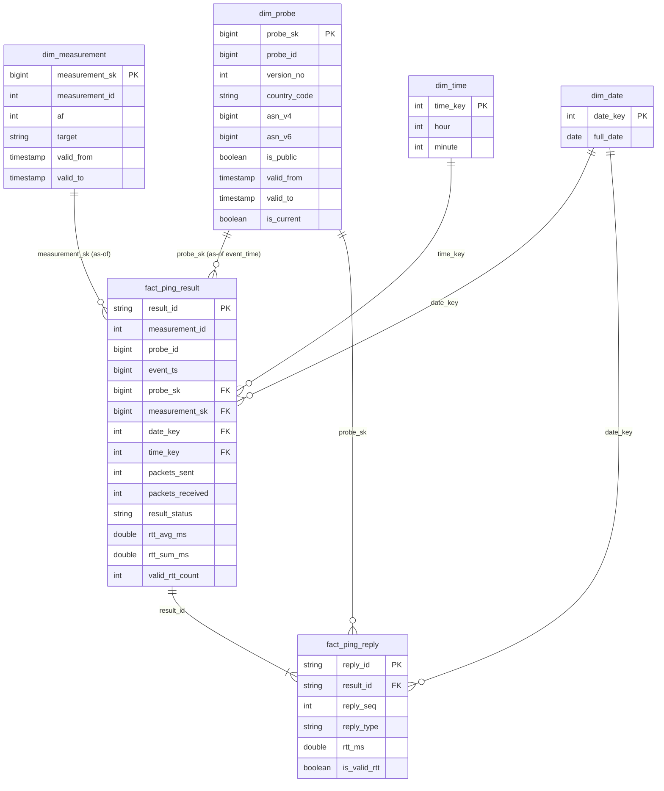

# Silver: star schema, data dictionary và quy tắc chuẩn hóa

Phiên bản: v1 (giai đoạn 3, 2026-11-19).
Code tương ứng:
- `spark/lakehouse/silver.py` (biến đổi)
- `spark/lakehouse/quality.py` (kiểm tra chất lượng)
- `spark/jobs/silver_build.py` (job)
- `sql/silver/001_tables.sql` và `sql/ops/001_tables.sql` (DDL)

## 1. ERD

**Cố ý giữ một số cột phi chuẩn hóa trong fact:** `country_code`, `asn`, `af`, `target`. Đây là giá trị lấy từ phiên bản dimension as-of tại `event_time`. Lý do:
- Superset và Trino lọc hoặc group theo các cột này rất thường xuyên; giữ sẵn trong fact giúp truy vấn không phải join.
- Giá trị đã "đóng băng" đúng phiên bản lịch sử, không bị ảnh hưởng khi dimension đổi sau này.

**Chưa có dimension địa lý hay ASN riêng.** API probes chỉ cho mã quốc gia ISO alpha-2 và số ASN, không có tên.
- Bổ sung tên quốc gia/vùng hoặc tên ASN cần một nguồn tham chiếu bên ngoài, có phiên bản (ví dụ bảng ISO 3166 + UN M49).
- Việc này cần chủ đồ án duyệt nguồn trước khi tải; xem `docs/status.md`.
- Bản đồ quốc gia của Superset dùng trực tiếp mã alpha-2, nên chưa có tên quốc gia vẫn vẽ được bản đồ.

## 2. Căn cứ ngữ nghĩa, đo trên 44.340 result thật trong Bronze

| Quan sát | Kết quả | Hệ quả |
|---|---|---|
| `rcvd` = số phần tử có `rtt` và **không** có `dup` | 44.340/44.340 khớp | `packets_received = rcvd`; reply trùng không phải packet nhận hợp lệ |
| `avg = -1` ⇔ `rcvd = 0` | 1.358 = 1.358; không có giá trị âm nào khác | `-1` là sentinel "không có RTT" → `NULL` ở trường chuẩn hóa |
| Kiểu phần tử của mảng `result` | `{rtt}`, `{rtt,ttl}`, `{dup,rtt[,ttl]}`, `{x:"*"}`, `{error}` | Phân loại thành reply / duplicate / timeout / error |
| `sent = 0` | 22 result, mỗi result có 1 phần tử `error`, ví dụ "Network is unreachable" | Lỗi gửi phía probe, **không** phải mất gói |
| Số phần tử của mảng lớn hơn `sent` | Có, khi có duplicate (ví dụ `sent=3`, 6 phần tử) | Không dùng số phần tử làm mẫu số |

## 3. Data dictionary

### `silver.fact_ping_result`

- **Grain:** một result của một probe, cho một measurement, tại một timestamp nguồn.
- **Business key:** `(measurement_id, probe_id, event_ts)`. `af` được xác định bởi `measurement_id`.
  - Đã kiểm tra trên 44.340 dòng Bronze: số khóa phân biệt = số dòng.
- **Partition:** `ictrl_dt, measurement_id`. Sort: `probe_id, event_ts`.
- **Cách ghi:** overwrite động theo partition, tính lại **toàn bộ** ngày bị ảnh hưởng từ Bronze (xem §5).

| Cột | Kiểu | Null | Định nghĩa |
|---|---|---|---|
| `result_id` | string | không | `sha256("ping_result\|" + measurement_id + "\|" + probe_id + "\|" + event_ts)`, số nguyên ở dạng thập phân, không đệm. Không phụ thuộc payload, nên ổn định khi chạy lại hoặc khi nguồn sửa dữ liệu |
| `measurement_id`, `af`, `target` | int, int, string | không | `af` và `target` lấy theo cấu hình đã đối chiếu metadata |
| `probe_id` | bigint | không | |
| `event_ts`, `event_time` | bigint, timestamp | không | Timestamp nguồn, UTC |
| `event_hour_utc` | timestamp | không | `date_trunc('hour', event_time)` |
| `ictrl_dt` | date | không | Ngày Asia/Ho_Chi_Minh của `event_time` |
| `date_key`, `time_key` | int | không | `yyyyMMdd` và `HHmm` theo giờ Asia/Ho_Chi_Minh |
| `probe_sk` | bigint | không | Phiên bản `dim_probe` as-of `event_time`; `-1` = unknown member |
| `measurement_sk` | bigint | không | Tương tự, với `dim_measurement` |
| `country_code`, `asn` | string, bigint | có | Lấy từ phiên bản probe as-of. `asn` = `asn_v4` nếu af=4, `asn_v6` nếu af=6 |
| `public_status` | string | không | `public`, `not_public` hoặc `unknown`, theo `is_public` của phiên bản as-of |
| `metadata_basis` | string | không | `asof_snapshot`; `assumed_from_first_snapshot` (event trước snapshot đầu tiên); `no_metadata` |
| `packets_sent` | int | có | `sent` của nguồn |
| `packets_received` | int | có | `rcvd` của nguồn (reply hợp lệ, không tính duplicate) |
| `packets_lost` | int | có | `sent − rcvd` khi `sent > 0` và `rcvd ≤ sent`; ngược lại `NULL` |
| `duplicate_count_src` | int | có | Trường `dup` của nguồn |
| `result_status` | string | không | `all_received` (rcvd = sent > 0), `partial_loss`, `all_lost` (sent > 0, rcvd = 0), `send_error` (sent = 0), `inconsistent` (thiếu hoặc rcvd > sent) |
| `has_response` | boolean | không | `rcvd > 0` |
| `src_rtt_min`, `src_rtt_avg`, `src_rtt_max` | double | có | Giữ nguyên giá trị nguồn, kể cả `-1` |
| `rtt_min_ms`, `rtt_avg_ms`, `rtt_max_ms` | double | có | Trường nguồn nếu ≥ 0, ngược lại `NULL` |
| `reply_element_count` | int | không | Số phần tử trong mảng `result` |
| `valid_rtt_count` | int | không | Số phần tử reply hợp lệ: có `rtt ≥ 0`, không `dup` |
| `rtt_sum_ms`, `rtt_sumsq_ms2` | double | có | Tổng và tổng bình phương RTT hợp lệ, dùng để gộp mean/variance |
| `duplicate_reply_count`, `timeout_count`, `error_count`, `unknown_element_count` | int | không | Đếm theo loại phần tử |
| `counts_consistent` | boolean | không | `valid_rtt_count = packets_received` |
| `ttl`, `packet_size`, `proto`, `dst_addr` | | có | Trường nguồn. `from`/`src_addr` (IP probe) **không** đưa vào Silver, chỉ còn trong Bronze |
| `fw`, `mver`, `lts`, `stored_ts`, `ingest_delay_s` | | có | `ingest_delay_s = stored_ts − event_ts` |
| `clock_suspect` | boolean | không | `lts < 0` hoặc `stored_ts < event_ts`. `event_ts` do đồng hồ probe ghi; đo ngày 2026-11-19: 712/44.340 result từ 3 probe, độ lệch tới −7.725 s. Gold có thể loại hoặc gắn cờ khi gom theo thời gian |
| `source_version_count`, `is_source_corrected` | int, boolean | không | Số bản payload khác nhau trong Bronze cho cùng khóa |
| `record_uid`, `raw_sha256`, `ingest_run_id`, `probe_set_version` | string | không | Truy vết tới Bronze và staging |
| `silver_run_id`, `silver_loaded_at` | | không | |

### `silver.fact_ping_reply`

- **Grain:** một phần tử trong mảng `result` của **bản result đã được chọn**.
- **Khóa:** `(result_id, reply_seq)`, trong đó `reply_seq` là vị trí 0-based trong mảng; `reply_id = sha256(result_id|reply_seq)`.
- **Partition và cách ghi:** giống `fact_ping_result`, ghi cùng partition nên khi tính lại thì reply của result bị sửa cũng được thay.
- **Duplicate reply:** giữ dòng với `reply_type = duplicate`, nhưng `is_valid_rtt = false`.

| Cột | Định nghĩa |
|---|---|
| `reply_type` | `reply` (có rtt, không dup); `duplicate`; `timeout` (`x`, đã quan sát toàn là `"*"`); `error`; `unknown` (không có `rtt`, `x` lẫn `error`) |
| `rtt_ms` | `rtt` của nguồn cho `reply` và `duplicate` |
| `is_valid_rtt` | `reply_type = reply` và `rtt ≥ 0` |
| `reply_ttl`, `error_message` | |
| Cột mang theo từ result | `measurement_id`, `af`, `probe_id`, `probe_sk`, `event_time`, `ictrl_dt`, `date_key`, `country_code`, `asn`, `public_status` (để percentile không cần join) |

### `silver.dim_probe` (SCD Type 2)

- **Natural key:** `probe_id`. **Surrogate key:** `probe_sk = xxhash64("probe|" + probe_id + "|" + valid_from)`, ổn định khi build lại từ cùng snapshot. `-1` là unknown member.
- **Tracked attributes:** `country_code, asn_v4, asn_v6, prefix_v4, prefix_v6, is_public, is_anchor, latitude, longitude`.
  - `attr_hash = sha256(to_json(struct(tracked)))`.
  - **Không track** `status` (Connected/Disconnected), `address_*` hay `tags`: các trường này đổi liên tục, sẽ sinh hàng loạt phiên bản vô nghĩa, và địa chỉ IP là dữ liệu nhạy cảm.
- **Version mới** chỉ được tạo khi `attr_hash` khác snapshot liền trước. Snapshot giống hệt chỉ tăng `observation_count` và `last_observed_at`.
- **`valid_from`** = `observed_at` của snapshot đầu tiên có giá trị mới. Thời điểm thay đổi thật nằm đâu đó trong khoảng `(prev_version_last_observed_at, valid_from]`; hai mốc này được lưu để biết mức độ chắc chắn.
- **`valid_to`** = `valid_from` của phiên bản kế tiếp (exclusive). Phiên bản cuối có `9999-12-31` và `is_current = true`.
- **`join_from`** = `1970-01-01` cho phiên bản đầu tiên, `valid_from` cho các phiên bản sau.
  - As-of join dùng điều kiện `join_from ≤ event_time < valid_to`.
  - Nhờ vậy fact xảy ra trước snapshot đầu tiên (backfill) vẫn join được, với `metadata_basis = assumed_from_first_snapshot`.
- Probe `fetch_status = not_returned` không tạo phiên bản mới.

### `silver.dim_measurement` (SCD Type 2)

- Cùng cơ chế với `dim_probe`.
- **Tracked attributes:** `af, target, target_ip, interval_s, packets, packet_size, is_public, status_name, msm_type`.

### `silver.dim_date`, `silver.dim_time`

- `dim_date`: từ 2010-01-01 đến 2035-12-31, theo **ngày Asia/Ho_Chi_Minh**. Cột: `date_key, full_date, year, quarter, month, month_name, day, day_of_week (1 = thứ Hai), day_name, iso_week, is_weekend`.
- `dim_time`: 1.440 phút trong ngày. Cột: `time_key = HHmm, hour, minute, hour_label, part_of_day`.

## 4. Chọn bản ghi khi nguồn trả payload khác cho cùng khóa

Thứ tự ưu tiên, deterministic: `fetched_at` mới nhất → `stored_ts` mới nhất → `raw_sha256` lớn nhất (để phá hòa).

- `source_version_count` và `is_source_corrected` cho biết khóa nào từng có nhiều phiên bản. Mọi phiên bản vẫn nằm trong Bronze.
- **Giới hạn:** quy tắc "bản quan sát mới nhất thắng" dựa trên giả định rằng RIPE chỉ sửa theo hướng đúng hơn. API không có trường nào cho biết phiên bản nào là bản "đúng".

## 5. Cách ghi, độ trễ dữ liệu và phục hồi

- **Phạm vi tính lại:** mỗi lần chạy nhận khoảng `[start, end)`, quy ra các ngày `ictrl_dt` bị ảnh hưởng, rồi tính lại **cả ngày, cho cả 4 measurement**, từ toàn bộ Bronze của các ngày đó.
  - Bản ghi bị thay thế, reply con của result bị sửa và nhóm `country`/`ASN` đổi do metadata đều tự đúng sau khi tính lại.
- **Dimension:** build lại toàn bộ từ mọi snapshot mỗi lần chạy (dữ liệu nhỏ, deterministic).
- **Metadata đến muộn:** probe chưa có metadata nhận `probe_sk = -1`. Lệnh `--repair-unknown` tìm các ngày có fact `probe_sk = -1` mà probe nay đã có trong `dim_probe`, rồi tính lại các ngày đó.
- **Atomicity:** mỗi `overwritePartitions` là một commit nguyên tử trên một bảng. Thứ tự: dims → `fact_ping_result` → `fact_ping_reply` → `ops.partition_status`.
  - Job chết giữa chừng thì partition chưa được đánh dấu `published`. Chạy lại cùng phạm vi sẽ tính lại và ghi đè (idempotent).

## 6. Chất lượng dữ liệu và chặn công bố

- Kiểm tra chạy **trước khi ghi**, trên chính DataFrame sắp được ghi.
- Có lỗi `critical`: **không ghi** fact; partition được đánh dấu `blocked` trong `ops.partition_status`, và bản đã công bố trước đó được giữ nguyên.
- Chỉ có lỗi `warn`: vẫn ghi, đánh dấu `published_with_warnings`.
- Sau khi ghi, đếm lại dòng của partition; nếu lệch thì đánh dấu `blocked` và ghi hướng dẫn rollback.
- Danh sách rule: `spark/lakehouse/quality.py`. Kết quả lưu vào `ops.dq_result`; Data Docs của GX ở `artifacts/gx/`.
- **Mất gói nặng không phải lỗi dữ liệu.** Result `all_lost` là kết quả đo hợp lệ và được giữ nguyên. Chỉ vi phạm hợp đồng dữ liệu mới bị coi là lỗi, ví dụ `rcvd > sent` hoặc trùng khóa.
